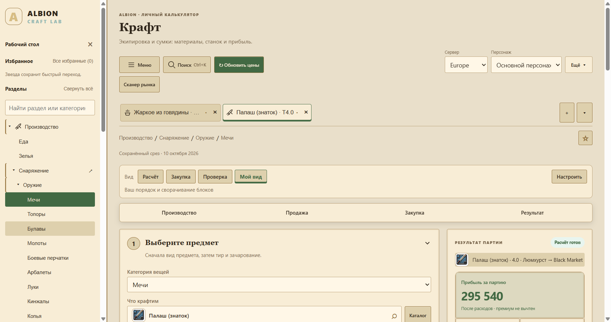
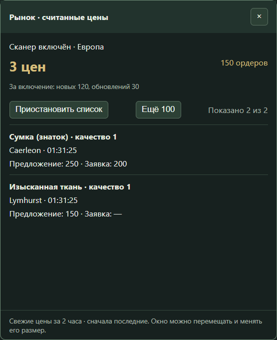

# Albion Lab

**Крафт, рынок, перевозки, маршруты и игровая статистика в одном приложении для Albion Online.**

Albion Lab помогает посчитать себестоимость и прибыль, спланировать производство и закупки, сохранить свои цены и построить маршрут между локациями. Интерфейс на русском языке, данные пользователя хранятся на его компьютере.

[](https://github.com/sashasychev05-sketch/albion-craft-lab/releases/latest)
[](https://github.com/sashasychev05-sketch/albion-craft-lab/releases/latest)
[](https://github.com/sashasychev05-sketch/albion-craft-lab/actions/workflows/release.yml)

**[Скачать для Windows](https://github.com/sashasychev05-sketch/albion-craft-lab/releases/latest)** · [Инструкции](#документация) · [Сообщить о проблеме](https://github.com/sashasychev05-sketch/albion-craft-lab/issues)



*Интерфейс приложения. На снимках используются демонстрационные данные; указанные цены не являются актуальными рыночными котировками.*

## Возможности

| Направление | Что можно делать |
| --- | --- |
| **Крафт** | Рассчитывать экипировку, сумки, еду и зелья с учётом материалов, станка, возврата ресурсов, фокуса, налогов и логистики. |
| **Ресурсы** | Планировать цепочки переработки, выбирать промежуточные этапы, сравнивать закупку готовых материалов и самостоятельное производство, считать трансмутацию. |
| **Работа с предметами** | Оценивать зачарование, улучшение качества, разбор предметов и производство ездовых животных. |
| **Цены и рынок** | Обновлять котировки и историю продаж AODP для Европы, Америки и Азии; сохранять ручные цены; получать цены при просмотре рынка в игре. |
| **Закупки** | Выбирать города закупки, распределять материалы между городами, объединять потребности партий, пользоваться деревом ингредиентов и списком закупок поверх игры. |
| **Продажи и перевозки** | Сравнивать способы продажи и города, учитывать оборот рынка, планировать рейсы, груз и перевозку предметов роскоши. |
| **Учёт партий** | Сохранять произведённые партии, покупки и продажи, учитывать частичную реализацию, остатки и выставленные заявки; экспортировать таблицы в CSV. |
| **Персонажи и острова** | Вести профили мастерства, рассчитывать фокус и прокачку, планировать доходность островов, грядок, животных и рабочих. |
| **Авалон и открытый мир** | Искать зоны и доступные объекты в справочнике, считывать подсказки порталов, вести граф переходов, искать маршруты и круги по выбранным условиям. |
| **Рабочий стол** | Открывать независимые вкладки, сохранять варианты расчёта и избранное, искать предметы через `Ctrl+K`, настраивать темы и расположение блоков. |

## Установка

1. Откройте [последний стабильный выпуск](https://github.com/sashasychev05-sketch/albion-craft-lab/releases/latest).
2. Скачайте `Albion-Lab-Setup-<версия>-x64.exe` и установите приложение. Для запуска без установки скачайте `Albion-Lab-<версия>-portable.zip`, распакуйте архив целиком и запустите `Albion Lab.exe`.
3. Выберите сервер и нужный раздел. Для расчёта можно загрузить рыночные цены или ввести свои.

Обновления доступны из приложения: **«Проверить обновления» → «Скачать обновление» → «Обновить и перезапустить»**. Новая версия устанавливается поверх старой с сохранением профиля.

Требуется **64-разрядная Windows 10 или 11**. Интернет нужен для обновления публичных рыночных данных, загрузки обновлений и первоначального получения дополнительных компонентов. Сохранённые данные, локальные иконки и ручные расчёты доступны без подключения.

## Сканирование рынка

Движок на базе [Albion Online Data Project](https://github.com/ao-data/albiondata-client) встроен в поставку Albion Lab и работает в фоне. Отдельно выбирать или запускать клиент не нужно.

1. Установите [Npcap](https://npcap.com/#download) в режиме **WinPcap API-compatible Mode**, если драйвера ещё нет.
2. Откройте **«Сканер рынка»**, выберите сервер игры и включите сканирование.
3. Просматривайте товары, предложения и заявки на рынке в игре. Полученные цены сохраняются локально и поступают в существующие расчёты.

Окно поверх игры показывает количество цен и ордеров, новые и повторно считанные записи, предметы, города и время считывания. Список можно приостановить для чтения, раскрыть дополнительные строки, переместить окно и изменить его размер.



**Как работают данные:**

- Считываются только те страницы и ордера, которые игра загрузила при просмотре рынка. Весь рынок автоматически не обходится.
- Считанные ордера хранятся два часа; ручные цены имеют приоритет в расчётах.
- Движок передаёт данные только локальному приёмнику Albion Lab на `127.0.0.1`. Публичная отправка цен этим встроенным движком не используется.
- Сервер выбирается перед включением сканера. Одновременно запущенные сторонние клиенты сбора данных управляются отдельно.
- Считывание цены не подтверждает наличие всего нужного объёма или ликвидность предмета. История продаж и проверки полноты расчёта учитываются отдельно.

Подробнее: [работа сканера и хранение данных](docs/MARKET-SCANNER.md).

## Маршруты Авалона

В разделе Avalon Checker доступны справочник зон, карты, заметки, избранное и граф обнаруженных переходов. Узлы графа можно перемещать, а маршруты — искать между двумя точками или по кругу с условиями по объектам и ресурсам.

Для распознавания подсказок требуется однократный импорт компонентов из полной папки Avalon Checker. После импорта приложение использует свою копию движка; исходный интерфейс Checker не запускается. Клавишу или кнопку мыши для сканирования можно настроить в Albion Lab.

Справочник показывает известные объекты локации. Текущее наличие ресурсов и зачистка объектов не определяются; для части зон открытого мира изображения карты отсутствуют. Поведение окон в эксклюзивном полноэкранном режиме игры отдельно не подтверждено.

[Подключение и использование Avalon Checker](docs/AVALON-CHECKER.md).

## Статистика игры · Statistics Analysis Tool

Кнопка **«Статистика игры»** открывает встроенный SAT в окне Albion Lab. В поставку входят его исходные разделы: обзор сессий, урон и лечение, лут и слава, подземелья, собирательство, торговля, крафт, группа, гильдия, склады, история перемещений, информация об игроке, каталог предметов и настройки.

При первом запуске мастер попросит указать папку Albion Online. Для захвата игровых событий нужен Npcap; .NET входит в установщик. Настройки, история и резервные копии SAT хранятся в отдельной папке профиля Albion Lab. Обновляется модуль вместе с приложением.

Используется [Statistics Analysis Tool](https://github.com/Triky313/AlbionOnline-StatisticsAnalysis) от Triky313 и участников проекта. Родной интерфейс и обработчики SAT сохранены; часть надписей остаётся на английском. [Подключение, функции и ограничения проверки](docs/STATISTICS-ANALYSIS.md).

## Данные и расчёты

Настройки, профили персонажей, черновики, ручные цены и граф маршрутов хранятся локально. Учётная запись Albion Lab и отдельный сервер не требуются. Данные Windows-приложения находятся в `%APPDATA%/Albion Craft Lab`; прежнее имя папки сохранено для совместимости обновлений.

Результаты зависят от полноты и свежести введённых данных. Отсутствующие цены, недостаток истории продаж и незаданные параметры отображаются в расчёте. Возврат ресурсов рассчитывается как математическое ожидание; прогноз прибыли не гарантирует фактический результат сделки.

Браузерная версия интерфейса доступна в `dist/`. Она использует отдельное локальное хранилище; встроенный захват трафика, глобальные клавиши и отдельные окна поверх игры относятся к приложению Windows.

## Документация

| Тема | Руководство |
| --- | --- |
| Установка, обновления и сборка | [Приложение Windows](docs/DESKTOP.md) |
| Рыночные цены из игры | [Сканер рынка](docs/MARKET-SCANNER.md) |
| Закупки поверх игры и работа без сети | [Мини-окно закупок](docs/SHOPPING-MINI-OFFLINE.md) |
| Закупки и города | [Автоподбор закупки](docs/AUTO-PROCUREMENT.md) · [Распределение по городам](docs/CITY-ALLOCATION.md) |
| Партии и торговый учёт | [Карточки партий](docs/BATCH-CARDS.md) · [Операции с партиями](docs/BATCH-OPERATIONS.md) |
| Состав производства | [Дерево ингредиентов](docs/INGREDIENT-TREE.md) |
| Цены, комиссии и экономика | [Экономика](docs/ECONOMY.md) |
| Острова | [Планирование островов](docs/ISLANDS.md) |
| Переходы и маршруты | [Avalon Checker](docs/AVALON-CHECKER.md) |
| Вкладки, избранное и поиск | [Рабочий стол](docs/WORKSPACE.md) · [Поиск по каталогу](docs/CATALOG-SEARCH.md) |

## Разработка

Стек: **Electron, JavaScript, HTML/CSS**. Встроенный движок захвата рыночных данных собран на **Go**, модуль SAT — на **C# / WPF / .NET 10**.

Для работы с исходниками нужны Node.js 24, npm и .NET SDK 10. Перед первым запуском статистики соберите модуль:

```powershell
npm ci
npm run build:statistics
npm start
```

Проверки и сборка установщика Windows:

```powershell
npm test
npm run build:win
```

Готовые сборки создаются в `release/`. Исходники интерфейса находятся в `dist/`, код приложения Windows — в `desktop/`, проверки — в `tests/`, инструкции — в `docs/`.

Для пересборки встроенного движка установите Go и выполните `scripts/build-market-engine.ps1`. Готовый движок уже включён в репозиторий; его происхождение и порядок сборки описаны в [BUILD.md](desktop/vendor/aodp/BUILD.md).

## Обратная связь и компоненты

Нашли ошибку? [Создайте issue](https://github.com/sashasychev05-sketch/albion-craft-lab/issues) и укажите версию приложения, сервер, раздел, действия для повторения и ожидаемый результат. Перед публикацией снимков и журналов проверьте, что в них нет личных данных.

Рыночные данные предоставляются экосистемой [AODP](https://www.albion-online-data.com/). Встроенный движок основан на `ao-data/albiondata-client`; его [лицензия MIT](desktop/vendor/aodp/LICENSE) сохранена в поставке. Компоненты распознавания Авалона подключаются отдельно через импорт.

Albion Lab — независимый проект для игроков; он не связан с Sandbox Interactive.

Объединённая программа распространяется под [GNU GPL-3.0](LICENSE). [Лицензии и авторство компонентов](THIRD_PARTY_NOTICES.md). Соответствующие исходники SAT и изменения интеграции включены в `third_party/statistics-analysis`; установщик собирается из этого репозитория.
